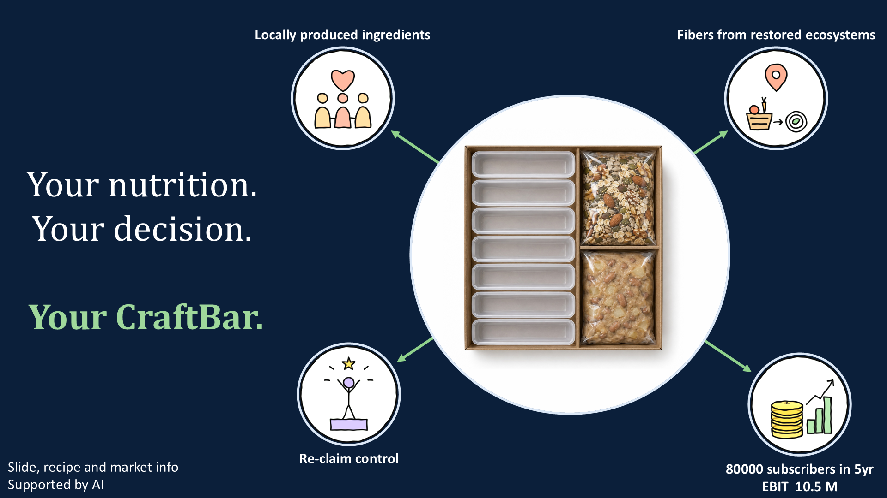
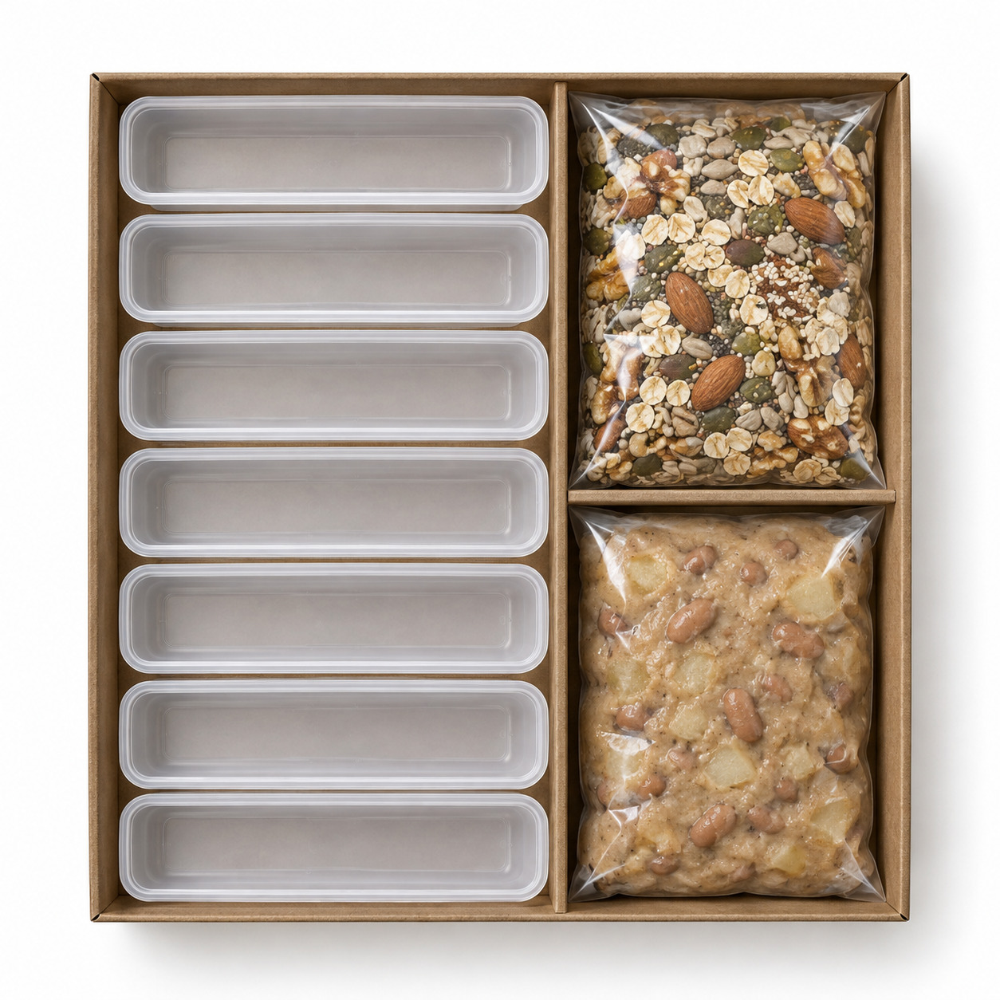
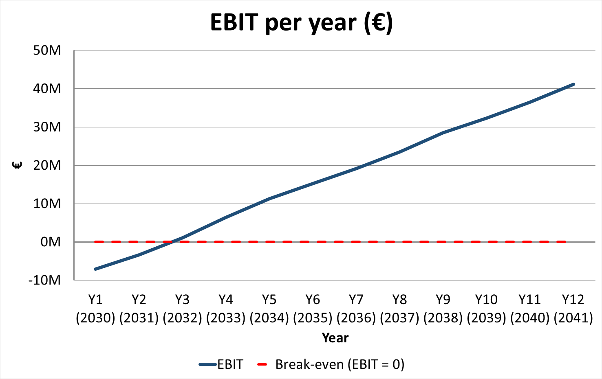
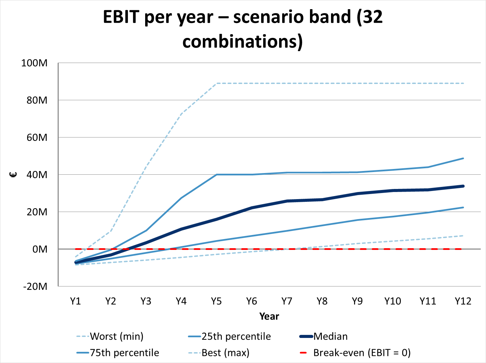

# CraftBar

**Your nutrition. Your decision. Your CraftBar.**

CraftBar is the business case our team built in two days at the [**Career Evolution Games Week 2026**](https://transforming-chemistry.org/event-details/career-evolution-games-week/), a career training programme organised by the **Max Planck Society** in Leipzig (October 2026).

### ▶ [Try the live app demo](https://yudingshechu.github.io/craftbar/)

  

*Title slide of our pitch.*

## The challenge

At the Games Week, we Max Planck scientists were split into groups, and every group received the same business case material. Each group acted as a start-up: it developed a sustainable nutrition product for plant-based consumers, built a business plan for it and pitched it to a jury.

## The idea

A protein bar should be a healthy snack. But even with every ingredient listed on the back, it is hard to really know what you are putting into your body. If you want a fast, convenient and healthy snack today, you have to give up control over your nutrition and simply trust the producer.

**Not with us.** CraftBar takes the production of the bar from the factory to your home: it is a **kit to craft your own complete nutrition bar at home in 5 minutes**. Reclaim control over your nutrition, with quick convenience on your terms.

We chose **Gen Z in Germany** as our target group at launch. Gen Z deeply believes in combining health with convenience and cares about sustainability. Germany is one of Europe's largest consumer markets. At the same time, vegan and vegetarian consumers can find it hard to get enough of some nutrients, such as **selenium, zinc and iron**. CraftBar is designed to close these gaps.

## The product

  

*Product visual of the weekly box (AI-generated image).*

### What is in the box

One weekly box makes **seven bars**:

| Part | What it is |
|---|---|
| **Nut and seed mix** | Rolled oats with a seasonal blend of European nuts and seeds, for example almonds, walnuts, hazelnuts, pistachios, pumpkin, sunflower, flax and hemp seeds. |
| **Fruit-and-bean cream** | Its recipe is adjusted with the seasons to keep the supply chain sustainable. |
| **Seven reusable moulds** | Press the mixture into the moulds, then store the bars in the mould or take them with you. The moulds can be reused, so customers can also order the box without moulds, with the food only. |

### How it works

1. **Tell the app what you need.** Choose your diet and the nutrients you are short on.
2. **Get a tailored recipe.** The app picks the nut and seed blend and the cream for your needs and the current season.
3. **Craft your bars** at home in 5 minutes.
4. **Share** your recipe in the community.

### Nutrition

- Recommended amounts of all **macronutrients**.
- A **complete plant-based amino acid profile**.
- Naturally present **selenium, zinc and iron**, which support the immune system and energy levels. This benefits vegan customers in particular.

## Sustainability

- **Locally produced ingredients**, sourced directly from European producers.
- **Seasonal:** nuts fresh from the harvest and a cream adjusted with the seasons.
- **Fibres from restored ecosystems.**
- **Plant-based** ingredients.
- **Reusable moulds.**

## What we did in two days

As a group, we first defined the question we wanted to answer. We then split the business case into tasks, such as product design, market sizing, the financial plan, the app demo and the pitch. Each of us picked a task and worked on it in a sub-group, and at the end we combined all parts into one pitch.

The product was at the centre of our work. We started from the consumer problem, designed the box and its ingredients, and built a clickable app demo so that the idea can be tried, not only described.

For the market size, we used **two independent methods**: (1) diet groups, i.e. vegans and vegetarians, and (2) how often people eat vegetarian alternatives, based on the forsa *Ernährungsreport 2025* survey tables and population projections for 2030. For the financial plan, we built a profit and loss model for a weekly subscription box at **€20.99**, compared our growth assumptions with **yfood** and **Huel**, and tested the plan in **32 scenarios** that combine both market-sizing methods with four drivers: customers at start, boxes per customer, growth, and spill-over to older generations.

### Market and demographics (Germany, 2030)

Demographic data by generation, used for both market-sizing methods:

| Generation | Population 2030 | Vegan | Vegetarian | Eat veg. alternatives daily | Eat veg. alternatives often (incl. daily) |
|---|---:|---:|---:|---:|---:|
| **Gen Z** | 14,400,000 | 6 % | 14 % | 14 % | 56 % |
| Gen Y | 17,400,000 | 3 % | 5 % | 12 % | 43 % |
| Gen X | 17,500,000 | 1 % | 5 % | 8 % | 35 % |
| Boomers | 17,200,000 | 1 % | 5 % | 4 % | 17 % |

Resulting market size in potential customers:

| Generation | Method 1: vegans + vegetarians | Method 2: daily consumers of veg. alternatives |
|---|---:|---:|
| **Gen Z (core target)** | 2,880,000 | 2,016,000 |
| Gen Y | 1,392,000 | 2,088,000 |
| Gen X | 1,050,000 | 1,400,000 |
| Boomers | 1,032,000 | 688,000 |
| Older generations total (Y + X + Boomers) | 3,474,000 | 4,176,000 |

*Sources: diet shares and consumption frequency from forsa, Ernährungsreport 2025, Ergebnisse einer repräsentativen Bevölkerungsbefragung; population projections for 2030 are team data (Gen Z: Eurostat EUROPOP2025). Older generations enter the model only through a spill-over effect from Gen Z.*

### Key figures

| | |
|---|---|
| Price | €20.99 per weekly subscription box |
| Gross margin | 75 % |
| Subscribers | 10,000 in year 1 · about 80,000 after 5 years |
| EBIT | €10.5 million projected after 5 years |

### Financial model

  

  

*EBIT per year in the base case (top) and across all 32 scenarios (bottom), from our financial model.*

## The app demo

The demo is a single, self-contained HTML file in [`docs/index.html`](docs/index.html). No build step, no backend; it runs in any browser and on phones.

- **Calorie calculator:** estimates daily energy and macro needs and how many bars fit in.
- **Craft your bar:** pick your diet and the nutrients you are short on; the app builds a seasonal recipe and shows nutrients per bar, ingredient shares and allergens.
- **Community:** sample posts, likes, and sharing a recipe card to social media.
- **Seasons:** switch the season at the top. The recommended nuts and cream change, and the app colours shift gently with it (spring: pea and strawberry; summer: apricot and pistachio; autumn: apple and walnut; winter: chestnut and oat). Layout and controls stay the same, so there is nothing new to learn.

Community posts are sample content and nutrient values are rounded from public food-composition tables for illustration.

## How we used AI

As stated on our title slide, our slides, recipes and market information were supported by AI. We used it in three ways:

**1. Information collection.** AI assistants helped us find comparable companies and their growth figures, data from the forsa survey tables, population projections and launch benchmarks. Every assumption in our model has a real-world source, listed next to each input in the spreadsheet. We checked the sources and decided which numbers to use.

**2. Pitch slides and product visual.** AI supported the content of our pitch slides, and the product picture of the box was created with AI.

**3. Demo creation.** Instead of static mock-ups, we built a **working, clickable app** with an AI coding assistant, so the product can be tried rather than just described.

## Team

Created by Group 1 at the Career Evolution Games Week 2026, Max Planck Society, Leipzig.

- Gewei Cao
- Mira Erhart
- Elyès Gaaloul
- Luisa Gensch
- Andres Tangarife-Escobar
- Laura von Selzam
