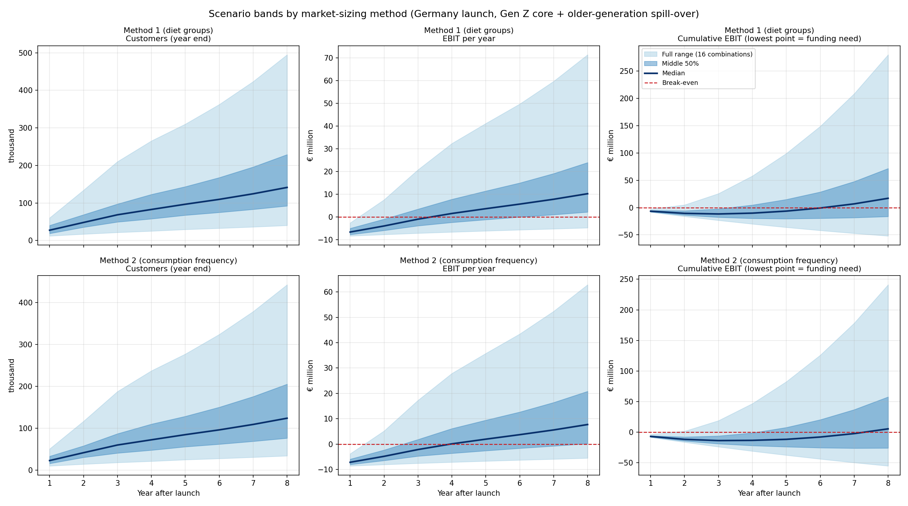

# CraftBar

**Your nutrition. Your decision. Your bar.**

CraftBar is the business case our team built in two days at the **Career Evolution Games Week 2026**, a career training programme organised by the **Max Planck Society in Leipzig** (October 2026). Each team received a business-case brief and had to develop a product idea, size its market, build a financial plan and pitch it to a jury.

**▶ Live app demo:** https://&lt;your-github-username&gt;.github.io/craftbar/ *(enable GitHub Pages, see below)*

<p align="center">
  
</p>

## The idea

Most protein and nutrition bars are a black box: a fixed recipe, a long ingredient list, and no way to adapt them to what *you* actually need. CraftBar turns that around.

- **You control what goes into your bar.** Tell the app what you are short on (for example iron, zinc, omega-3 or B12 on a vegan diet) and it generates a **tailored recipe**.
- **A weekly subscription box** delivers the ingredients: a seasonal European nut and seed mix, a fruit-and-bean cream, and seven reusable moulds. Press, chill, and your bars for the week are ready.
- **Full transparency.** The app keeps track of every nut, seed and ingredient in your bars, including nutrients per bar and allergens.
- **Seasonal and local.** Nuts and creams change with the harvest season, sourced directly and locally.
- **Community.** Users share their recipes and their "craft week" with friends.

Target group at launch: **Gen Z in Germany**, a generation that wants to combine health with convenience, starting with vegans and vegetarians.

## What we did in two days

| Step | What we did |
|---|---|
| **Problem & product** | Defined the customer problem, designed the box (see picture above) and the app concept. |
| **Market sizing** | Estimated the German Gen Z market with **two independent methods**: (1) diet groups, i.e. vegans and vegetarians, and (2) consumption frequency of vegetarian alternatives, based on the [forsa *Ernährungsreport 2025*](https://www.bmleh.de/) survey tables and Eurostat population projections for 2030. |
| **Unit economics** | Built a per-box P&L: €20.99 recommended price per weekly box, 20 % trade margin, €4.20 cost of goods, giving a 75 % gross margin on net sales. |
| **Benchmarking** | Anchored every growth and adoption assumption in a real-world comparable (yfood, Huel, KoRo, mymuesli, Feed., NielsenIQ launch data). |
| **Scenario analysis** | Combined 2 market-sizing methods × 4 drivers (start customers, boxes per customer, growth, spill-over to older generations) into **32 scenarios** to see how robust the plan is. |
| **App demo** | Built a clickable app prototype: calorie calculator, "craft your bar" recipe builder and community feed. |
| **Pitch** | Presented the case to the jury. |

### Key results (base case, Germany)

- Median break-even in **year 3** across all 32 scenarios.
- Median financing need of about **€10 M** before losses are repaid.
- Even the worst-case scenario (all drivers pessimistic) needed no more than about **€30 M**, while the best case broke even in year 2.

<p align="center">
  
</p>

*Scenario bands for both market-sizing methods: full range of combinations, middle 50 % and median.*

## The app demo

The demo is a single, self-contained HTML file in [`docs/index.html`](docs/index.html). No build step, no backend; it runs in any browser and on phones.

- **Calorie calculator:** estimates daily energy and macro needs and how many bars fit in.
- **Craft your bar:** pick your diet and the nutrients you are short on; the app builds a seasonal recipe and shows nutrients per bar, ingredient shares and allergens.
- **Community:** sample posts, likes, and sharing a recipe card to social media.
- **Seasons:** switch the season at the top. The recommended nuts and cream change, and the app colours shift gently with it (spring: pea and strawberry; summer: apricot and pistachio; autumn: apple and walnut; winter: chestnut and oat). Layout and controls stay the same, so there is nothing new to learn.

Community posts are sample content and nutrient values are rounded from public food-composition tables for illustration.

## How we used AI

In a two-day sprint, AI tools were part of the team, not just a spell-checker. We used them in two ways that were new to most of us.

**1. AI for information collection.**
Instead of spending hours searching for numbers, we used AI assistants as research partners: to find comparable companies and their growth figures, to pull the relevant shares out of the 100-page forsa survey tables, and to locate population projections and launch benchmarks. The rule we kept: **every assumption in the model needs a real-world source**, and the spreadsheet has a "real-world basis" column next to each input. AI found the candidates fast; we checked the sources and decided which numbers to use.

**2. AI for demo creation.**
Instead of static mock-up slides, we described the product to an AI coding assistant and iterated on a **working, clickable app** within hours: a real recipe engine, nutrient calculations and a community feed. This let the jury try the product idea rather than just hear about it. AI also helped us turn the financial model into the scenario analysis and charts above.

The ideas, the decisions and the pitch were ours; AI made it possible to get from idea to evidence-backed model and working prototype in two days.

## Repository structure

```
craftbar/
├── README.md            this file
├── assets/              product picture and scenario chart used in this README
└── docs/
    ├── index.html       the app demo (served by GitHub Pages)
    └── .nojekyll
```

## Publishing the demo with GitHub Pages

1. Push this repository to GitHub.
2. Go to **Settings → Pages**.
3. Under *Build and deployment*, choose **Deploy from a branch**, branch `main`, folder `/docs`.
4. After a minute the demo is live at `https://<your-github-username>.github.io/craftbar/`.

## Team

Created by our team at the Career Evolution Games Week 2026, Max Planck Society, Leipzig.

<!-- Add team member names here -->
